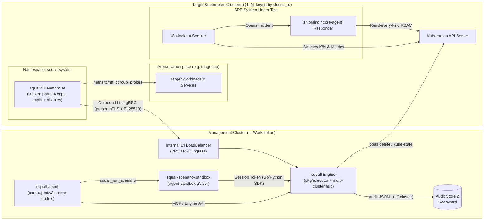

# squall Design

**Status:** proposed
**Date:** 2026-11-20
**Module:** `github.com/go-steer/squall`

## TL;DR

1. **Close the answer leak at the injection layer.** When an autonomous SRE agent (`shipmind` / `core-agent`) investigates an incident with cluster-wide read access, custom-resource chaos operators hand it the diagnosis via core `v1` `Event`s and per-pod shadow objects. `squall` injects runtime faults with **zero per-fault Kubernetes objects and zero injector Events**, holding fault kind/target (`K`) and parameters (`F`) to zero under wildcard-read RBAC (`R`).
2. **Split execution into a multi-cluster external engine (`squall`) and a zero-listen, self-reverting node agent (`squalld`).** One `squall` management plane serves *N* target clusters from outside those clusters so its audit stream is unreachable via target `pods/log`. Pod loss is a plain Kubernetes `pods delete`. Network delay, packet loss, L3/L4 partition, container kill, and CPU/memory burn run through `squalld` — a DaemonSet (`hostPID`, four capabilities, no container runtime socket, no Kubernetes API token, **zero listening network ports**) that dials outbound over bi-directional gRPC + `purser` mTLS to `squall`'s management-cluster Internal L4 LoadBalancer, verifies Ed25519-signed command leases, arms a node-local `tmpfs` timer, and backs partitions with `nftables` kernel set timeouts.
3. **One asynchronous protobuf Engine API backs CLI, MCP, and Go/Python SDKs.** `SubmitFault` returns a lease handle immediately without blocking on multi-minute settle probes; heartbeated, budgeted scenario sessions let multi-fault programs react to live cluster state and automatically reap every active fault if the caller crashes or misses a heartbeat.
4. **Build `squall-agent` on `core-agent/v3` + `core-models` under four independence rules.** The engine imports zero LLM packages; audit ground truth comes strictly from confirmed engine state; fixed deterministic scenario packs run alongside LLM-chosen faults; and startup validation enforces model-family diversity against the SRE agent under test (for example, running Claude on `anthropic-vertex` when the subject runs Gemini on `vertex`).
5. **Run agent-authored scenario code in network-fenced gVisor sandboxes (`sigs.k8s.io/agent-sandbox`).** Scenario programs compile and execute against prewarmed Go/Python SDK caches (~4s `go build`) with no Kubernetes API token and `NetworkPolicy` egress restricted exclusively to the `squall` Engine API and read-only arena metrics. Every fault still traverses `pkg/executor`.
6. **Keep every fault in the catalog and separate detection from diagnosis.** Faults that `k8s-lookout` does not currently wake on (such as pure network delay) stay in the catalog, score as `not_detected` rather than diagnosis failures, and expose their empirical detection status to the planner.

---

## 1. Problem & Measured Evidence

`squall` is built to stress Kubernetes workloads and serve as clean ground truth for evaluating autonomous SRE agents (`k8s-lookout` + `shipmind`). Three empirical runs on `shipmind-stage` (GKE Standard + Dataplane V2, 2026-11-19) established why custom-resource chaos engines contaminate agent benchmarks and what a replacement must do.

### 1.1 Step 1 benchmark: how custom-resource chaos leaks the answer

Running `simian-agent` v0.4.0 autonomously for 4.5 hours against `shipmind-stage` (`triage-lab` arena) applied **27 confirmed faults**:

- **12 of 27 faults** triggered `k8s-lookout` incidents (15 never woke the SRE agent, including **0 of 9** `NetworkChaos` delay faults and **0 of 1** `NetworkPolicy` partitions).
- **11 of 12 incidents** produced graded `core-agent` diagnoses (`claude-sonnet` judge via `shipmind scenario judge`), yielding **5 correct diagnoses**.
- **3 of the 5 correct diagnoses were contaminated by Chaos Mesh leaks** (4 sessions overall named the Chaos Mesh object in their final answer, and 7 of 17 session transcripts contained Chaos Mesh strings in tool outputs). Only **2 of 27 faults** produced a clean, uncontaminated end-to-end detection and diagnosis.
- **Root mechanism of the leak:** In **4 of 4** leaked answers, the agent's first exposure to chaos metadata came from an ordinary core `v1` `Event` listing in `triage-lab` (written by `chaos-controller-manager`'s event recorder), followed by targeted queries for the `NetworkChaos` or `PodChaos` object whose name the Event revealed. Denying `chaos-mesh.org` RBAC removes parameter reads (`F`) while leaving fault kind, name, and target pod (`K`) exposed in `v1` `Event`s — which Kubernetes's built-in `view` ClusterRole grants. Furthermore, GKE's hosted read-only MCP server (`https://container.googleapis.com/mcp/read-only`) enforces Kubernetes RBAC when IAM is scoped to `roles/mcp.toolUser` + `container.clusters.{connect,get,list}`, confirming that in-cluster API objects and Events are the sole leak boundary.

### 1.2 Live GKE direct-daemon spike: zero API footprint works on Dataplane V2

Before committing to a custom node agent, we drove an idle `chaos-daemon` pod directly over gRPC on `shipmind-stage` with `chaos-controller-manager` bypassed:

| Check | `netem` Delay (`317ms`) | Partition (drop inbound + outbound) |
|---|---|---|
| Measured client RTT | `3ms` baseline → `~638ms` live → `3ms` after clear | `3s` timeout live → `3ms` after clear |
| `chaos-mesh.org` objects cluster-wide | `0` | `0` |
| Target pod metadata, spec, and status | Byte-identical to pre-fault snapshot | Byte-identical to pre-fault snapshot |
| Core / `events.k8s.io` Events naming fault | `0` | `0` |
| Fault parameters across 169 listable API types | `0` | `0` |
| Node daemon stdout (`pods/log`) | **Leaked full parameters, pod UID, and container ID** | **Leaked full parameters, pod UID, and container ID** |

Reading Chaos Mesh v2.8.4 source alongside the spike confirmed why we cannot simply drive `chaos-daemon` in production: its 16 gRPC methods carry **no TTL, duration, or deadline** (if the controller crashes mid-fault, the fault persists indefinitely), it mounts the node's container runtime socket, and it logs every request's parameters to stdout.

### 1.3 Live `k8s-lookout` v0.43.1 sentinel run: transition rules and async submit

Testing all 8 existing `kube-state` lookout-pack kinds one by one against `shipmind-stage`'s sentinel woke `shipmind` on **5 of 8 kinds** (`ContainerExitLoop`, `ImageUnresolvable`, `MemoryLimitSqueeze`, `Unschedulable`, `RolloutStuck`) and stayed silent on **3 of 8** (`SelectorDrift`, `PDBGridlock`, `CertExpiry`):

- **Transition-only detectors:** `k8s-lookout`'s `pkg/sources/objectstate/objectstate.go` fires `endpoints_empty` and `pdb_gridlocked` strictly on `>0 -> 0` transitions (*"Creations are not transitions"*). Born-broken `Service` and `PodDisruptionBudget` fixtures never trip the sentinel; two-step fixtures (create healthy, observe `>0`, then break) or live workload mutations are required.
- **Scan cadence:** `expiry.warning` scans `Secret`s via paged `LIST` every `--expiry-interval` (default `1h`), missing a 6-minute `CertExpiry` window unless fault TTL exceeds the scan interval or test clusters configure a shorter interval.
- **Synchronous submit failure mode:** `Unschedulable` requires a `5m30s` `pending_dwell` settle gate, causing a 5-minute synchronous CLI submit call to time out even though the fault succeeded. Engine submission must return asynchronously as soon as the lease is reserved and injected.

---

## 2. Settled Decisions & Out of Scope

### Settled decisions (do not relitigate)

1. **Separate public repository (`go-steer/squall`).** Leave `go-steer/simian-agent` intact for Chaos Mesh workflows and its `oracle_read` benchmark. Carry over proven non-Chaos-Mesh domain packages (`executor`, `arena`, `lease`, `probe`, `audit`, `kubestate`, `networkpolicy`) with attribution.
2. **No Chaos Mesh dependency.** Use plain Kubernetes `pods delete` for pod loss, `squalld` for pod-netns and cgroup faults, protocol load generation for overload, `kube-state` synthesized/mutated objects for Kubernetes control-plane scenarios, and `network-policy` where policy visibility is the intended diagnosis.
3. **Multi-target external engine + outbound `squalld` reverse streams.** Run one `squall` control plane outside the target clusters (serving *N* registered target clusters keyed on `(cluster_id, arena)`) so neither its state nor its audit stream is reachable via target-cluster `pods/log`. Each `squalld` pod dials outbound over bi-directional gRPC to `squall`'s Internal L4 LoadBalancer so target clusters expose zero inbound ports or Services; timed network efficacy probes execute inside each target cluster on `squalld`.
4. **Leak bar at wildcard-read RBAC (`R`).** Presence of chaos infrastructure (`P`) is permitted; fault kind/target (`K`) and parameters (`F`) must be zero for an investigator able to read every Kubernetes resource kind and `pods/log`.
5. **Unified protobuf Engine API + heartbeated sessions + SDKs.** One Engine API contract serves MCP tools and generated Go/Python SDKs so both declarative tool calls and imperative agent-written scenario scripts share identical safety, lease, and audit guarantees.
6. **Agent on `core-agent/v3` + `core-models`, scenario code in `agent-sandbox` gVisor.** Build `squall-agent` on `github.com/go-steer/core-agent/v3` (`go-steer/mast` is frozen) and `github.com/go-steer/core-models`, enforce model-family diversity against the SUT, and execute scenario code in prewarmed gVisor sandboxes (never Yaegi).
7. **Keep every fault; score detection separately.** Undetected faults remain in the catalog, report as `not_detected` without penalizing diagnosis accuracy, and surface their detection status to the planner.

### Out of scope

- **Sidecar-less L7 HTTP fault injection** (requires transparent socket interception; Envoy sidecar or protocol load driver covers L7).
- **Disk IO delay/errno injection** (requires FUSE/`toda` in-container mounts) and **`ptrace`/vDSO clock skew**.
- **`k8s-lookout`'s 10 read-path CLI fixtures** (`chatty-logs`, `broken-edges`, `broken-webhook`, `config-drift`, `drain-blockers`, `hpa-thrash`, `cpu-pressure`, `broken-workloads`, `secret-workload`, `store-postmortem`), which emit no wire signals by design.
- **In-process Go interpreters (`Yaegi`)**, rejected in `kode-gopher` after 16/32 differential test failures and 7 silent wrong outputs.
- **Retrofitting `go-steer/simian-agent`** or building on frozen `go-steer/mast`.

---

## 3. Leak Threat Model & Acceptance Bar

We classify observable artifacts by what they reveal to an investigating SRE agent:

- **`P` (Presence):** Chaos infrastructure or arena opt-in furniture exists on the cluster (`squall-system` DaemonSet, arena namespace annotation, arena RBAC `Role`). **Allowed.**
- **`K` (Kind or Target):** Which fault kind ran or which specific workload/pod `squall` targeted (beyond natural failure symptoms such as ` exitCode: 137`, `BackOff`, or readiness probe `Unhealthy` Events). **Must be zero (`0`).**
- **`F` (Full Parameters):** Delay milliseconds, loss percentage, drop CIDRs, burn targets, or planner rationale. **Must be zero (`0`).**

| Channel | Reveals if Unmitigated | Access Level | `squall` Mitigation |
|---|---|---|---|
| Custom resources & per-pod shadow CRs | `F`, `K` | Wildcard read (`R`) | None created; zero custom CRDs installed in target cluster |
| Core `v1` & `events.k8s.io` `Event`s | `K` | Built-in `view` (`V`) | `squall` and `squalld` instantiate no Kubernetes Event recorder |
| Ephemeral containers / pod-failure spec rewrites | `F`, `K` | `V` | Never used (`spec.ephemeralContainers` is immutable for pod life) |
| Synthesized object names, labels, images | `P`, `K` | `V` | Neutral naming/labels; zero kind/action tokens in specs or images |
| Controller & node-agent stdout (`pods/log`) | `F`, `K` | `V` (cluster-bound) | Engine runs off-cluster; `squalld` logs opaque `fault_id`s only |
| Unauthenticated `pods/proxy` or lateral pod scraping of node agent | `F`, `K` | `R` (wildcard `get`) | `squalld` opens **zero listening sockets** in normal operation (dials outbound bi-directional gRPC + `purser` mTLS to `squall`) |
| GKE Cloud Audit Logs on `pods delete` | `P` (`squall` principal), target pod | GCP IAM `logging.viewer` | Accepted when subject lacks Cloud Logging IAM; documented under `T9` |

### Enforce zero K and F leak budget at wildcard-read RBAC {#LEAK-1}

Every runtime fault driver must pass automated leak checks `T1`–`T3`, `T6`, and `T7` on `kind` and GKE (and `T9` on GKE environments where the subject holds Cloud Logging access), evaluated both while the fault is live and 60 seconds after `Clear` using an investigator credential with read access to every API resource kind (`R`):

| Check | Procedure | Pass Criterion |
|---|---|---|
| `T1` Object sweep | Diff every listable resource in API discovery (excluding `Secret` payloads) against pre-fault snapshot | Zero objects outside `squall-system` carry injector API groups, fault kind/action names, or fault parameters |
| `T2` Event sweep | List core `v1` and `events.k8s.io` `Event`s cluster-wide | Zero Events reference `squall`, `squalld`, a fault kind, or a `fault_id` (kubelet symptom Events like `Killing` or `Unhealthy` are valid symptoms) |
| `T3` Pod spec diff | Diff target pod `metadata` and `spec` against pre-fault snapshot | Byte-identical for netns/cgroup/container-kill faults; `spec.ephemeralContainers` empty |
| `T6` Post-clear residue | Repeat `T1`–`T3` 60s after `Clear` | Diff against pre-fault state contains only expected workload recovery state |
| `T7` Hard-kill self-reap | `SIGKILL` the `squall` engine mid-fault; wait `lease_expires_at` + one reap tick | Fault reverts autonomously on `squalld`, `T6` passes, and restarting `squall` records `agent-self-reverted` |
| `T9` Cloud Logging sweep | Query GKE Cloud Logging over `[injected_at, cleared_at + 60s]` | Container logs carry zero `K` or `F` entries; Admin Activity principal on `pods delete` is documented |

*Object-is-the-fault exemption:* For `kube-state` and `network-policy` faults, the broken Kubernetes manifest itself is the failure the SRE agent must diagnose (`ImagePullBackOff`, `PodDisruptionBudget` floor, deny `NetworkPolicy`); naming that object's misconfiguration is the valid diagnosis, subject to `#LEAK-2`.

### Strip fault tokens from every driver and keep audit off in-cluster stdout {#LEAK-2}

Unit and integration test `T4` must assert across every driver (`podkill`, `squalld`, `load`, `kubestate`, `networkpolicy`) and every written string field — object names, labels, annotations, container names, image references, environment variables, and command arguments — that no field contains the fault `Kind`, `Action`, `squall`, or `simian` diagnosis hints (replacing legacy strings like `simian-no-such-image` with neutral workload-shaped identifiers). Check `T5` must read `pods/log` for every pod reachable by the wildcard-read subject role in the target cluster and assert zero occurrences of audit JSON records, planner rationales, or fault parameter values.

### Widen oracle_read across tool results and final answers {#LEAK-3}

`squall`'s evaluation package must implement `T8` (widened `oracle_read`), scanning both every tool-call output in the SRE agent's session transcript and its final answer text for injector kind tokens, `squall` identifiers, and `fault_id`s. Any match marks the trial `contaminated` and fails regression checks on zero-leak drivers.

---

## 4. Architecture & Engine Core

### Heritage: what carries over from `simian-agent` vs. built fresh

| Component | Disposition | Notes |
|---|---|---|
| `pkg/executor` | **Port & tighten** | Chokepoint pipeline (`validate -> safety -> reserve -> lease -> narrow -> precheck -> driver -> confirm -> settle -> recovery -> audit`), refactored for async submission and session leases |
| `pkg/arena`, `pkg/sut` | **Port & adapt** | Opt-in namespace annotations, steady-state baseline capture, arena RBAC (`pods` `delete` added; `chaos-mesh.org` dropped; `User` + `ServiceAccount` subjects supported) |
| `pkg/lease`, `pkg/audit` | **Port & extend** | Add `agent-self-reverted` tombstone reason, off-cluster-only audit sinks, and `ground_truth` vs `claims` provenance split |
| `pkg/probe` | **Port & split** | `k8s` and `logs` probes stay in `squall`; timed TCP/HTTP dial and qdisc/nft read-back move to `squalld` |
| `pkg/driver/kubestate`, `networkpolicy` | **Port & expand** | Strip `simian-*` markers (`#LEAK-2`), convert transition fixtures to two-step healthy→broken, add mutate mode and 5+ lookout wire kinds |
| `cmd/squalld`, `pkg/nodeagent` | **Build fresh** | `purser` mTLS + Ed25519 lease verifier, `/proc` netns/cgroup resolver, `tc netem`, `nftables` set-timeout partitions, PID kill, CPU/mem burner, `tmpfs` self-reaper |
| `api/squall/v1`, `pkg/sdk`, `sdk/python` | **Build fresh** | Protobuf Engine API, heartbeated scenario sessions, MCP server adapter, Go and Python SDKs |
| `pkg/driver/load` | **Build fresh** | Bounded HTTP/gRPC traffic & concurrency overload generator |
| `cmd/squall-agent`, `pkg/sandbox` | **Build fresh** | Embedded `core-agent/v3` + `core-models` diversity gate + `agent-sandbox` gVisor runner |

### Route every fault through the single executor pipeline {#ENG-1}

Every fault mutation — whether initiated from the `squall` CLI, an MCP tool call, an autonomous campaign turn, or an imperative Go/Python SDK call inside a scenario sandbox — must traverse `pkg/executor`:

`validate -> safety (arena opt-in, blast-radius cap, concurrency budget, cooldown) -> reserve -> mint lease -> narrow targets -> precheck steady state -> driver Apply -> confirm injected -> settle window -> Clear -> verify recovery -> append audit record`.

No driver, CLI subcommand, or SDK endpoint may invoke `squalld` or mutate target-cluster resources outside `pkg/executor`.

### Run the engine outside target clusters as a multi-cluster hub {#ENG-2}

One `squall` engine instance runs outside the target clusters (in a dedicated `squall` management cluster, or on a workstation/CI runner) and manages **one or more named target clusters** configured in an explicit target registry (`clusters[cluster_id] -> {kubeconfig, context, allowed_arenas, node_tier_enabled}` — never an ambient default kubeconfig context). All executor safety gates, concurrency limits, cooldown timers, and active lease records are keyed on **`(cluster_id, arena)`** from day one so `triage-lab` arenas across `stage`, `canary`, and `dev` clusters never collide:

1. **Outbound node-agent hub via Internal L4 LoadBalancer:** In the management cluster, `squall` sits behind a single standard Kubernetes **Internal L4 `LoadBalancer` Service** (optionally published via Private Service Connect across disjoint or CIDR-overlapping VPCs). Because `squalld` streams are stateful, `squall` runs active/passive leader election and reports HTTP `Ready` to the Internal L4 LoadBalancer health check **only on the active leader replica**, guaranteeing that all `squalld` streams and Engine API requests land on the authoritative lease coordinator (with automatic stream reconnect on failover).
2. **Zero target-cluster ingress:** Each `squalld` pod dials outbound to `squall`'s Internal L4 LoadBalancer VIP (or the Docker host gateway on `kind`). Target clusters expose **zero LoadBalancers, zero Kubernetes `Service`s, and zero listening ports** for `squalld` (an opt-in `--dev-loopback-listen` mode on `127.0.0.1` + `pods/portforward` exists solely for standalone laptop-to-cloud testing when no management cluster is deployed).
3. **Minimal target-cluster RBAC:** Per target cluster, `squall` holds only a read-only discovery `ClusterRole` for topology/steady-state prechecks and per-arena `RoleBinding`s (`ServiceAccount` or Workload Identity `User` subjects) granting `pods` `delete` and `kube-state` / `network-policy` verbs inside opt-in arena namespaces (no `pods/proxy` or `pods/portforward` needed in normal operation).

### Inject pod loss via plain Kubernetes pod deletion {#ENG-3}

The `podkill` driver implements single-pod and bounded multi-pod loss by issuing standard Kubernetes `CoreV1().Pods(arena).Delete` calls (with configurable `GracePeriodSeconds`, defaulting to immediate `0` for crash simulation or workload default for graceful termination), producing natural kubelet replacement symptoms and zero custom objects or injector Events.

### Provide first-class load generation and overload faults {#ENG-4}

The `load` driver generates bounded HTTP/1.1, HTTP/2, and gRPC request rates, concurrency surges, and payload sizes against arena `Service` endpoints (executing from `squalld` or an isolated load worker in `squall-system` so traffic stays in-cluster). Every load fault is governed by an executor lease deadline, a hard RPS/bandwidth ceiling, and an automatic circuit breaker if non-arena node pressure is detected, enabling organic saturation, latency degradation, HPA scaling, and OOM symptoms without synthetic container wrappers.

### Synthesize and mutate kube-state faults across lookout wire scenarios {#ENG-5}

`squall` ports `simian-agent`'s `kube-state` engine without importing `k8s-lookout` code and closes the gaps identified against `k8s-lookout` v0.43.1's 17 wire scenarios:

| `k8s-lookout` Wire Scenario | Expected Lookout Signal | `squall` Kind & Mechanism |
|---|---|---|
| `crashloop` | `k8s-event` `BackOff` | `ContainerExitLoop` (synthesized & live Deployment mutate mode) |
| `image-pull` | `k8s-event` `BackOff` / `ErrImagePull` | `ImageUnresolvable` (neutral nonexistent tag, `#LEAK-2` clean; synthesized & mutate) |
| `oom` | `BackOff`, `objectstate.restart_burst` | `MemoryLimitSqueeze` (synthesized) + `squalld` cgroup memory burner + `load` |
| `pending` | `capacity.pending-aged`, `FailedScheduling` | `Unschedulable` (synthesized impossible resource request; async `5m30s` dwell) |
| `cert-expiry` | `expiry.warning` | `CertExpiry` (synthesized expiring TLS `Secret` with lease TTL configurable past `--expiry-interval`) |
| `pdb-gridlock` | `objectstate.pdb_gridlocked` | `PDBGridlock` (**two-step transition**: create healthy with `disruptionsAllowed > 0`, observe ready, then scale/tighten to `0`; plus mutate mode) |
| `endpoints-empty` | `objectstate.endpoints_empty` | `SelectorDrift` (**two-step transition**: create `Service` with ready `EndpointSlice`s, wait `>0`, then drift selector to `0`; plus live mutate mode) |
| `bad-rollout` | `rollout.stall`, `Unhealthy`, `BackOff` | `RolloutStuck` (two-step healthy Deployment rolled to failing revision; synthesized & mutate) |
| `failed-mount` | `k8s-event` `FailedMount` | `FailedMount` (new synthesized pod/Deployment mounting nonexistent `ConfigMap`/`Secret`) |
| `probe-flap` | `degradation.probe_flap` | `ProbeFlap` (new synthesized readiness-toggling workload without container restart, or `squalld` cyclic probe-port drop) |
| `cron-missed` | `workload.cron_missed` | `CronMissed` (new synthesized `CronJob` blocked by arena `ResourceQuota`, serialized as arena-wide) |
| `config-storm` | Multi-consumer restart `storm` | `ConfigStorm` (new multi-step fixture: 4 consumer Deployments watching shared config, then config broken/removed) |
| `hpa-metrics-dead` | `autoscaling.hpa_metrics_dead` | `HPAMetricsDead` (new synthesized `HorizontalPodAutoscaler` over request-less Deployment; supports `>15m` lease policy) |
| `gateway-cert` | `expiry.warning`, `gateway.*` | `GatewayCert` (optional kind enabled when Gateway API + `cert-manager` CRDs are present) |
| `missing-env` (`shipmind` e2e) | `BackOff` with missing env root cause | `MissingEnvConfig` (variant of `ContainerExitLoop` failing on required env key lookup) |

In **mutate mode**, `pkg/executor` snapshots the live arena resource's prior spec into its durable lease record before patching and restores the exact prior spec on `Clear` or orphan reap.

### Gate real node and topology faults behind an explicit dedicated-cluster tier {#ENG-6}

The remaining three `k8s-lookout` wire scenarios — `node-failure` (`objectstate.node_notready`), `zone-unavailable` (`leeway.domain_unavailable` via zone cordon), and `placement-drift` (`leeway.contract_violated` / `leeway.placement_drift` via node taint and release) — mutate cluster-scoped `Node` objects and affect pods outside the arena. `squall` groups `NodeFailure`, `ZoneUnavailable`, and `PlacementDrift` into an explicit `node` capability tier that defaults to **disabled** and refuses execution unless both the engine configuration (`--enable-node-tier`) and a cluster-scoped opt-in annotation confirm a dedicated test cluster, with `Node` cordon/taint state captured in the lease for guaranteed rollback.

---

## 5. Self-Reverting Node Agent (`squalld`)

### Run squalld with minimal capabilities, no API token, and no runtime socket {#NODE-1}

`squalld` deploys as a `DaemonSet` in `squall-system` on target worker nodes with:
- `hostPID: true` and `runAsUser: 0` (UID `0` is required so Linux retains the four capabilities across `execve` and permits DAC writes to root-owned `cgroup.procs`).
- `securityContext.appArmorProfile.type: Unconfined` (dropping `privileged: true` otherwise causes containerd's default AppArmor profile on GKE COS to deny cross-container `/proc/<pid>/ns/net` `ptrace` inspection and `signal` delivery).
- Linux capabilities dropped to `ALL` and adding strictly four capabilities: `CAP_NET_ADMIN` (netlink qdiscs and nftables inside target pod netns), `CAP_SYS_ADMIN` (`setns(2)` into `/proc/<pid>/ns/net` and cgroup v2 migration), `CAP_SYS_PTRACE` (reading `/proc/<pid>/ns/*` across container boundaries), and `CAP_KILL` (signaling target container PIDs).
- `automountServiceAccountToken: false` (**zero Kubernetes API credentials** on the node agent).
- **No host container runtime socket** (`/run/containerd/containerd.sock` is never mounted), eliminating node-wide image pull or arbitrary privileged container spawn primitives.
- Writable host `/sys/fs/cgroup` mount (for cgroup v2 burner subprocess attachment), read-only root filesystem (`distroless/static-debian12` using pure-Go netlink), and a dedicated `tmpfs` mount at `/run/squalld` (`size=16Mi`).

### Connect squalld outbound over bi-directional gRPC with per-cluster purser mTLS and Ed25519 command leases {#NODE-2}

In normal operation, `squalld` **never calls `net.Listen`** (`0` open ports in the target cluster), eliminating Kubernetes `pods/proxy` scraping, per-cluster LoadBalancer provisioning, and DaemonSet random-pod L4 routing in one stroke:

1. **Outbound bi-directional gRPC + per-cluster `purser` mTLS (`v0.5.0`):** On startup (and with jittered exponential backoff on disconnect), each `squalld` pod dials `squall`'s management-cluster Internal L4 LoadBalancer VIP using `purser/client` (`client.NewPKI` or federated `client.NewSPIFFE` with `CertificateFileSource` + `RootCAsSource` hot-reload) and opens `NodeAgentService.Connect(stream AgentEvent) returns (stream ControllerCommand)`. Each target cluster's `squalld` client certificate encodes its `cluster_id` in its SAN (`DNS: <cluster_id>.squalld.internal` or SPIFFE path `/cluster/<cluster_id>`), and `squall`'s `purser/authn/mtls` server rejects any `AgentHello{cluster_id, node_name, boot_id, live_leases, tombstones}` whose `cluster_id` does not match the verified mTLS certificate SAN (preventing a compromised dev cluster from spoofing a staging or production cluster on the hub) or that collides with an already-live stream for `(cluster_id, node_name)`. Because `squalld` applies `netem` and `nftables` inside the *victim pod's* `/proc/<pid>/ns/net`, `squalld`'s own pod network namespace and outbound gRPC stream remain unaffected by arena network faults.
2. **Per-command Ed25519 lease envelope:** `purser` authenticates the gRPC stream endpoints rather than individual fault leases. Exclusively inside `squall`'s `pkg/executor` — after `(cluster_id, arena)` safety checks pass — the executor signs every `ControllerCommand` pushed down the stream with an Ed25519 private key (`crypto/ed25519`; public key mounted read-only in `squalld`):
   `{command_nonce, fault_id, cluster_id, node_name, target_pod_uid, target_container_id, action, spec_sha256, issued_at, lease_expires_at}`.
   `squalld` verifies the Ed25519 signature, confirms `cluster_id` and `node_name` match its own identity, rejects expired or >30s clock-skewed `issued_at` envelopes, enforces a bounded max TTL ceiling, and tracks seen `command_nonce`s in a time-bounded anti-replay ring (allowing signed `Probe` and idempotent `Clear` commands for an active `fault_id`).

### Resolve target container PIDs, network namespaces, and cgroups from procfs {#NODE-3}

Without mounting containerd's CRI socket, `squalld` locates target containers deterministically on `Apply` by scanning `/proc/[0-9]*/cgroup` and `/proc/[0-9]*/mountinfo` for the pod UID (both dashed and systemd underscore-escaped forms) and container ID supplied in the signed command, filtering out pause/sandbox infrastructure containers (`k8s.gcr.io/pause`, `/pause`) when targeting application containers, and recording the resolved `/proc/<pid>/ns/net` inode (`netns_inode`) in its local `tmpfs` lease. Subsequent `Probe`, `Clear`, and timer-reap operations verify the target's `netns_inode` still matches the lease record before mutating state, preventing PID-reuse races if a container restarts mid-fault.

### Inject network, process-kill, and resource-burn faults inside target namespaces {#NODE-4}

`squalld` implements four native fault families via pure-Go netlink and syscalls (requiring no `tc` or `nft` userland binaries inside the distroless image):
- **Network delay, jitter, and packet loss (`netem`):** Enters `/proc/<pid>/ns/net` in a locked OS thread (`runtime.LockOSThread`) and attaches/replaces a `netem` qdisc over RTNETLINK (`florianl/go-tc`) on the pod's `eth0` veth interface (supporting optional destination CIDR/port filters via `tc` classification).
- **Network partition and DNS blackhole (`nftables`):** Enters `/proc/<pid>/ns/net` and programs a dedicated `nf_tables` `inet` table `squall_<fault_id>` over netlink (`google/nftables`) dropping matching inbound/outbound CIDRs, ports, or UDP/TCP port `53` (DNS failure without deploying an in-cluster spoofed DNS server). Using an isolated table per `fault_id` guarantees zero interference with GKE Dataplane V2 (Cilium eBPF / host routing) and atomic single-table netlink deletion on `Clear`.
- **Container process kill:** Sends `SIGKILL` (or configured signal) directly to the resolved container root PID (`pidfd_open` + `pidfd_send_signal` on Linux 5.4+ to eliminate PID-recycle races).
- **CPU and memory pressure:** Spawns a dedicated `squalld burn` **child subprocess** (never a Go thread — in cgroup v2 `domain` mode, writing a thread TID to `cgroup.procs` migrates the entire `squalld` thread group into the victim's cgroup and exposes `squalld` to the victim's OOM killer!) placed directly into the target container's cgroup v2 path (`CLONE_INTO_CGROUP` or `fork`/`exec` + `cgroup.procs`), burning the requested CPU millicores or allocating anonymous unswappable pages up to the configured byte budget so container-level metrics (`container_cpu_usage_seconds_total`, `container_memory_working_set_bytes`) and kernel OOM behavior match genuine workload runaway.

### Guarantee self-revert via node-local tmpfs leases and nftables kernel timeouts {#NODE-5}

`squalld` guarantees bounded fault lifetime even under total control-plane loss:
1. **Write-ahead `tmpfs` lease:** Before mutating a netns or cgroup, `squalld` atomically writes `/run/squalld/leases/<fault_id>.json` (`{fault_id, pod_uid, netns_inode, burner_pid, action, lease_expires_at}`) and arms an in-process monotonic deadline timer. When the timer fires, `squalld` reverts the fault (and kills any `burner_pid`) and moves the record to a bounded tombstone ring (`/run/squalld/tombstones/`).
2. **Kernel-enforced `nftables` positive lease-gate set timeout:** Every `inet squall_<fault_id>` table declares a scalar lease-gate set (`type nf_proto; flags timeout`) populated with `{ ipv4 timeout <ttl>s, ipv6 timeout <ttl>s }`, and every drop rule in the table matches `meta nfproto @lease_live` as its first expression (rather than attaching timeouts directly to CIDR interval or negated exemption sets, which either hit `nf_tables` `interval+timeout` constraints or invert `!= @exempt` rules into a 100% blackhole on expiry). When `<ttl>` elapses, the Linux kernel (`nf_tables`) expires `@lease_live` automatically — disarming every rule in the table on time even if **both** `squall` and `squalld` are `SIGKILL`ed and never restart.
3. **Crash recovery & push-first `AgentHello` reconciliation:** On `squalld` startup (after a daemon restart or upgrade), `squalld` reads `/run/squalld/leases/`, immediately reverts expired leases, re-arms timers for active leases, and sweeps any `squall_*` nftables tables or `netem` qdiscs lacking a live lease. Whenever `squalld` connects or reconnects its outbound gRPC stream (`#NODE-2`), its opening `AgentHello` frame pushes `{live_leases, tombstones}` directly to `squall`, enabling immediate lease adoption across engine restarts and draining tombstones so `pkg/audit` distinguishes `cleared`, `agent-self-reverted`, and `orphan-reaped`.

### Emit parameter-free logs and execute timed efficacy probes in-cluster {#NODE-6}

To pass `T5` (`#LEAK-2`) even if an investigator holds cluster-wide `pods/log` access, `squalld`'s structured logger emits only `{ts, level, fault_id, state}` (`applied`, `reverted`, `expired`, `rejected`) — never logging fault kind, pod name, namespace, pod UID, or numeric parameters. Additionally, `squalld` exposes a signed `Probe` RPC that executes qdisc/`nft` state read-back (`ConfirmInjected`) and timed TCP/HTTP dial measurements from inside the cluster (~1–5ms baseline RTT rather than 170–330ms workstation RTT), returning structured latency percentiles and error ratios to `squall`'s `pkg/probe` gates.

---

## 6. Unified Engine API, Scenario Sessions & SDKs

### Define one protobuf Engine contract with asynchronous submission and structured dry-run {#API-1}

`api/squall/v1/engine.proto` defines a single canonical multi-cluster contract served over gRPC and Connect/HTTP JSON, protected by `purser` (`v0.5.0`) `httpmw.Chain`, `httpmw.CheckBind`, `authn/{oidc,mtls,bearer}`, and `authz.Authorize` (recording `purser.Caller.Identity` in every audit entry). Every arena-scoped request carries `(cluster_id, arena)` explicitly:

- **`ListClusters`** *(read-only)*: Lists registered target `cluster_id`s, opt-in arenas per cluster, connected `squalld` node-stream counts, and `node` tier eligibility.
- **`InspectArena`** *(read-only)*: Returns `(cluster_id, arena)` topology, workload readiness, steady-state baseline, active leases, cooldown timers, and per-kind historical detection/diagnosis stats.
- **`DryRunFault`** *(read-only)*: Runs `validate -> safety -> narrow -> precheck` on `(cluster_id, arena)` without mutating state, returning resolved target pods, `squalld` stream readiness on the target nodes, and structured machine-readable refusal codes (e.g., `CLUSTER_UNKNOWN`, `ARENA_NOT_ENABLED`, `NODE_AGENT_DISCONNECTED`, `COOLDOWN_ACTIVE`, `BLAST_RADIUS_EXCEEDED`, `NODE_TIER_DISABLED`, `STEADY_STATE_UNHEALTHY`) so callers and LLMs self-correct deterministically.
- **`SubmitFault`** *(mutating, asynchronous)*: Reserves the `(cluster_id, arena)` safety lease, pushes `Apply`, and returns `{fault_id, cluster_id, lease_expires_at, stage: "INJECTING"}` immediately — never blocking on multi-minute settle gates.
- **`WaitFault` / `StreamFault`** *(read-only)*: Streams or blocks until a requested lifecycle stage (`CONFIRMED`, `SETTLED`, `CLEARED`, `RECOVERED`) with caller-controlled timeout.
- **`ObserveArena`** *(read-only)*: Queries live pod states, efficacy probes (via `squalld`), and `k8s-lookout` incident correlation hooks for `(cluster_id, arena)` during an active fault or cascade.
- **`ClearFault`** *(mutating, idempotent)*: Immediately triggers `Clear` and recovery verification before lease expiry.

### Enforce heartbeated, budgeted sessions for multi-step scenarios {#API-2}

Multi-step chaos scenarios — such as injecting backend latency, observing retry amplification, then killing one replica if queue depth crosses a threshold — open an explicit **`ScenarioSession`** (`OpenSession`, `HeartbeatSession`, `CloseSession`):
- `OpenSession` validates and pins `{campaign_id, allowed_targets: [(cluster_id, arena), ...], max_concurrent_faults, max_total_faults, max_fault_ttl, session_deadline, heartbeat_ttl}` (default `heartbeat_ttl: 30s`) and mints an ephemeral session-scoped bearer token.
- Every `SubmitFault` carrying that session token must match one of the session's `allowed_targets`, is accounted against the session's concurrency and total-fault budgets, and is clamped to `min(requested_ttl, max_fault_ttl, session_deadline - now)`.
- If the scenario program panics, hangs, is killed by its sandbox timeout, or misses `heartbeat_ttl`, `squall` automatically marks the session aborted and immediately `Clear`s every live fault tied to the session.

### Expose MCP tools and generated Go and Python SDKs from the same Engine API {#API-3}

Both agent tool calls and imperative scenario programs consume `squall/v1`:
1. **MCP server (`pkg/mcpserver`):** Wraps `squall/v1` over MCP Streamable HTTP and `stdio`, marking `ListClusters`, `InspectArena`, `DryRunFault`, `WaitFault`, and `ObserveArena` with `ReadOnlyHint: true` so `core-agent` dispatches inspection calls concurrently and gates only `SubmitFault`, `ClearFault`, and `RunScenario`.
2. **Go SDK (`pkg/sdk`) and Python SDK (`sdk/python/squall_sdk`):** Idiomatic, context-aware clients over `squall/v1` with automatic background session heartbeating (`sess.HeartbeatLoop(ctx)`) and `defer sess.Close()` cleanup helpers so an agent can author 30-line adaptive Go or Python programs that compose faults, probes, and conditional branches safely.

### Separate engine-verified ground truth from agent-claimed provenance in the audit trail {#API-4}

Every JSONL record in `pkg/audit` strictly separates two top-level sub-documents:
- **`ground_truth`** *(written exclusively by `pkg/executor`)*: `fault_id`, `session_id`, `caller_identity`, `cluster_id`, `engine`, `kind`, `arena`, exact resolved target coordinates (`namespace`, `workload`, `pod_uids`, `nodes`), `injected_at`, `confirmed_at`, `cleared_at`, `recovered_at`, `clear_reason` (`explicit`, `ttl-expired`, `session-aborted`, `agent-self-reverted`, `orphan-reaped`), and raw precheck/confirm/recovery probe measurements.
- **`claims`** *(optional metadata supplied by `squall-agent` or scenario code)*: `hypothesis`, `scenario_name`, `expected_lookout_signals`, and `expected_root_cause`.

Evaluation judges (`shipmind scenario judge` and `squall eval`) score SRE agents strictly against `ground_truth` and refuse to grade faults where `ground_truth.confirmed` is `false`.

---

## 7. Chaos Agent on `core-agent/v3` & `core-models`

### Build interactive and autonomous campaign modes on core-agent/v3 {#AGT-1}

`cmd/squall-agent` embeds `github.com/go-steer/core-agent/v3` (`go-steer/mast` is frozen at `v0.10.0` and folded into `core-agent/v3`) to serve both operating modes from one distroless-compatible Go binary:

1. **Interactive / prompt-driven mode:**
   - Local workstation CLI/TUI via `pkg/runner.Run` with `permissions.plan_mode: "required"` (`record_plan`), requiring operator approval of the fault plan and blast radius before mutating tools execute.
   - Remote multi-session daemon via `pkg/attach.NewServer` + `pkg/compose.SessionFactoryDeps` + `pkg/eventlog` (SQLite/Postgres) + `pkg/approval` (`OnMutationRequireApproval` durable write-gate parks). Because it speaks `core-agent`'s frozen attach protocol, `squall-agent` works out of the box with `core-agent-tui`, `mast-web` (`/ui/` and `/parks`), `switchboard` (Slack/Google Chat threads), `ax` on Agent Substrate (`127.0.0.1:8484` with `atenet-router.ate-system.svc.cluster.local` in `attach.allowed_hosts`), and A2A v0.3 (`/.well-known/agent-card.json` + `POST /a2a`).
2. **Unattended periodic campaign mode:**
   - Uses `compose.AcquireSchedulingLease` + `compose.NewScheduledTrigger` anchored durably in `pkg/eventlog`.
   - Wires a deterministic Go `PreFire` function that checks arena steady-state health, active leases, cooldown windows, settled prior-incident scoring, and remaining campaign USD/token budgets — advancing idle or cooling-down ticks with **zero LLM token spend**.
   - When `PreFire` passes, fires a bounded `autonomous.Run` turn (`agent.ModeAutonomous`, `WithMaxTurns`, `WithMaxCost`, `WithMaxInputTokens`, `WithMaxDuration`, `SafetyConfig{Watchdog: "enforce"}`) supplied with the arena snapshot and historical detection/diagnosis scorecard.

### Enforce the four independence rules and startup model-family diversity {#AGT-2}

Because `squall-agent` and `shipmind`'s SRE responder both build on `core-agent/v3` and `core-models`, `squall` enforces four structural independence rules to keep benchmarks scientifically valid:
1. **Engine zero-LLM boundary:** `cmd/squall`, `cmd/squalld`, `pkg/executor`, and all drivers/SDKs must never import `core-agent` or `core-models` (enforced in CI).
2. **Engine-only ground truth:** `pkg/audit` records `ground_truth` strictly from `pkg/executor` state (`#API-4`).
3. **Deterministic baseline packs:** Every evaluation campaign interleaves fixed, deterministic scenario packs alongside LLM-planned or LLM-coded scenarios so coverage does not depend solely on generative creativity.
4. **Startup model-family diversity check:** Campaign configuration declares `eval.sut_model_family` (for example, `"gemini"` when testing `shipmind`'s Vertex Gemini responder). At startup, `squall-agent` resolves `(provider, modelID)` across `core-models` profiles (`gemini`, `vertex`, `vertex-express`, `anthropic`, `anthropic-vertex`, `openai`, `vertex-maas`, `xai`, `vllm`, `sglang`, `ollama`) for `cfg.Model`, every `cfg.Subagents[*].Model`, `cfg.Permissions.Auto`, and any configured judge into canonical model families (`gemini`, `claude`, `gpt`, `grok`, `qwen`, `deepseek`, `llama`). Startup hard-fails if any `squall` role shares `eval.sut_model_family` — steering GCP deployments to `--provider=anthropic-vertex` (which uses the same GCP Workload Identity / ADC credentials as Vertex Gemini with zero additional API keys).

### Execute agent-authored scenario programs in network-fenced sandboxes {#AGT-3}

`squall-agent` ships as a `distroless/static-debian12:nonroot` image with `--disable-tools=bash` and exposes a dedicated **`squall_run_scenario`** tool rather than unrestricted shell execution:
- **In-cluster gVisor sandbox (`sigs.k8s.io/agent-sandbox`):** Following the proven `kode-gopher` architecture, `squall_run_scenario` claims a prewarmed `Sandbox` pod from a `SandboxWarmPool` (`runtimeClassName: gvisor`, `automountServiceAccountToken: false`, read-only rootfs except `/app` and `/tmp`). The sandbox image bundles `GOTOOLCHAIN=local`, `/opt/squall-base/sdk` (`github.com/go-steer/squall/pkg/sdk`), and a prebuilt `$GOCACHE` stamped with `2100-01-01` mtimes (avoiding Go cache-trim `chtime` overlayfs copy-ups so real `go build` + execution starts in ~4 seconds offline), alongside Python 3 + `squall_sdk`.
- **Strict network & credential fencing:** A Kubernetes `NetworkPolicy` restricts sandbox pod egress exclusively to `squall-engine`'s API endpoint (and optional read-only arena metrics). For each run, `squall` calls `OpenSession` (`#API-2`) and injects only `SQUALL_ENGINE_URL` and the ephemeral `SQUALL_SESSION_TOKEN` into the sandbox invocation. The scenario program cannot reach the Kubernetes API server, `squalld`, or arbitrary cluster workloads; every fault it requests passes through `pkg/executor`, and any sandbox timeout or crash revokes the session and reaps its faults.
- **Local developer fallback:** On workstations or `kind` clusters without `agent-sandbox` CRDs, `squall_run_scenario` executes the same runner inside `core-agent`'s OS sandbox (`bwrap --unshare-net` / network-scoped on Linux, `sandbox-exec` Seatbelt on macOS, or `docker run --read-only`).

### Keep every fault in the catalog and score detection separately from diagnosis {#AGT-4}

Evaluation campaigns and `squall-agent`'s planner treat observability detection and SRE diagnosis as orthogonal metrics:
- **Catalog completeness:** Faults that `k8s-lookout` v0.43.1 does not currently detect (such as pure `netem` delay or probe-preserving `NetworkPolicy` partitions) remain first-class citizens in `squall`'s catalog.
- **Two-stage scorecard:** Each confirmed fault (`ground_truth.confirmed == true`) is joined against incident openings in `[injected_at, cleared_at + grace]`. Faults that open zero incidents are scored `detection: not_detected` and excluded from the denominator of `diagnosis_accuracy`, reporting `(detection_rate, clean_diagnosis_accuracy, contamination_rate)` separately instead of conflating sentinel gaps with responder reasoning errors.
- **Detection-aware planning:** `InspectArena` and campaign memory expose per-kind empirical `detection_status` (`detected`, `not_detected`, `untested`) so campaigns can explicitly weight budget between testing responder diagnosis on detected kinds and probing sentinel blind spots or multi-fault cascades.

---

## 8. Milestones & Open Risks

### Roadmap

| Milestone | Scope | Exit Gate |
|---|---|---|
| **M1 — Zero-Leak Core & `squalld`** | Port `executor`, `arena`, `lease`, `audit`, `probe`; implement off-cluster `podkill` driver and `squalld` (`purser` mTLS + Ed25519 lease, procfs resolver, `netem`, `nftables` set-timeout partition, container kill, CPU/mem burner, `tmpfs` self-revert, in-cluster probes); automate `T1`–`T8` leak suite | `kind` + GKE `shipmind-stage` run of pod-kill, container-kill, partition, delay, and CPU burn passes `T1`–`T8` (`K = 0`, `F = 0` at wildcard-read RBAC) including `T7` `SIGKILL` controller crash self-reap |
| **M2 — Unified API, SDKs, Load & `kube-state`** | `squall/v1` protobuf gRPC/HTTP API (`purser` auth), async `SubmitFault` + `DryRunFault`, heartbeated `ScenarioSession`s, MCP server, Go & Python SDKs, `load` driver, and `kube-state` two-step transitions (`SelectorDrift`, `PDBGridlock`), mutate mode, and 5 new lookout wire kinds | All namespace-scoped `k8s-lookout` wire scenarios fire stage's sentinel (`endpoints_empty` and `pdb_gridlocked` verified live); aborted SDK session reaps active faults within `heartbeat_ttl` |
| **M3 — `squall-agent` & Scenario Sandbox** | `cmd/squall-agent` on `core-agent/v3` (`runner.Run`, `attach.Server`, `ScheduledTrigger` zero-token `PreFire`), `core-models` startup family-diversity gate, and `squall_run_scenario` over `agent-sandbox` gVisor warm pool + local `bwrap`/Seatbelt fallback | Interactive prompt authors and runs an adaptive multi-fault Go scenario in <10s compile+start inside gVisor; campaign startup refuses model-family collision against Gemini SUT |
| **M4 — Stage Benchmark & Node Tier** | Opt-in `node` tier (`NodeFailure`, `ZoneUnavailable`, `PlacementDrift`), `squall eval` two-stage detection/diagnosis scorecard, and full 4-hour `shipmind-stage` rerun (`anthropic-vertex` Claude attacker vs `vertex` Gemini responder) | Zero `T8` `oracle_read` contaminations across wildcard-read SRE responder transcripts; published baseline scorecard separating detection rate from clean diagnosis accuracy |

### Open risks

1. **Unverified kernel/OS details on GKE COS + Dataplane V2:** While `tc netem` was proven live in the 2026-11-19 GKE spike, pure-Go `nf_tables` netlink set-element kernel timeouts on Container-Optimized OS (COS), cgroup v2 path layout under GKE's systemd cgroup driver, `appArmorProfile.type: Unconfined` with the 4-capability profile, and outbound bi-directional gRPC stream reconnect behavior across Internal L4 LoadBalancer leader failovers require an immediate M1 validation spike on GKE.
2. **`netem` has no kernel-level TTL:** Unlike `nftables` sets (which expire in the kernel even if `squalld` dies), Linux `tc netem` has no built-in kernel timeout. If `squalld` is `SIGKILL`ed *and* Kubernetes cannot restart the `squalld` DaemonSet pod on that node, an active `netem` qdisc persists until `squalld` restarts or the victim pod is recreated.
3. **Ed25519 signing key blast radius:** Because `squalld` holds no Kubernetes API token (`#NODE-1`), it cannot independently query namespace annotations to verify arena membership. Compromise of the off-cluster Ed25519 private key + mTLS client identity allows fault injection against any pod on nodes running `squalld`. Mitigation: keep the private key off-cluster in memory/KMS, scope `squalld` `nodeSelector` to non-system/arena node pools where possible, and rotate short-lived signing keys.
4. **Privileged DaemonSet review surface:** `hostPID` plus `CAP_SYS_ADMIN`, `CAP_NET_ADMIN`, `CAP_SYS_PTRACE`, and `CAP_KILL` is root-equivalent on worker nodes running `squalld`. Dropping the CRI socket and API token narrows lateral movement, and dedicated node-pool scheduling isolates control-plane and production tenants.
5. **Cloud Audit Logs (`T9`):** A plain Kubernetes `pods delete` writes an Admin Activity / Data Access audit entry naming `squall`'s principal and the deleted pod in GKE Cloud Logging. For `shipmind` (which queries Kubernetes MCP rather than Cloud Audit Logs), `K = 0` holds; evaluating an SRE agent granted GCP Cloud Audit Log access requires filtering injector principal audit entries or routing `pods delete` through neutral node-level container termination.
